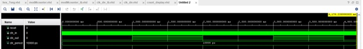
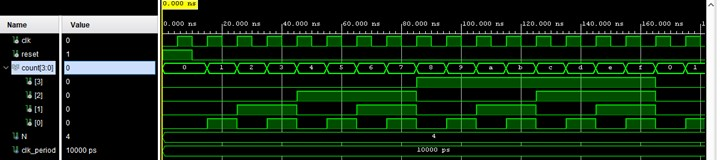

# Project 2: Event Counter

## 1. Introduction

This project involves designing and implementing a 4-bit modulo-16 counter using VHDL on the Digilent Basys3 FPGA board. The project consists of two stages: an automatic counter and a button-controlled event counter.

In **Part I**, a 100 MHz system clock is divided into a 1 Hz clock to increment the counter automatically. The count is displayed in hexadecimal (0–F) on the rightmost seven-segment display and in binary using four onboard LEDs.

In **Part II**, the automatic clock is replaced by a debounced push-button signal, allowing the counter to increment once per valid button press. A separate push button provides asynchronous reset functionality.

The main objectives were to develop sequential and combinational circuits in VHDL, integrate reusable modules, implement button debouncing, and verify the designs through simulation and FPGA implementation.

## 2. Design

### Part I — Automatic Counter

The design consists of three main functional blocks:

- **Clock Divider (`clk_div`)** — Divides the Basys3 100 MHz clock into a 1 Hz clock.
- **Modulo-16 Counter (`modMCounter`)** — Uses a four-bit unsigned register to count from 0 to F and automatically wrap around to 0.
- **Hexadecimal Decoder (`hex_7seg`)** — Converts the counter output into active-low seven-segment patterns.

The counter output also connects directly to four LEDs to display the binary count.

The clock divider uses:

\[
MAX\_COUNT=\frac{f_{in}}{2f_{out}}-1
\]

For a 100 MHz input and 1 Hz output:

\[
MAX\_COUNT=49,999,999
\]

The clock output toggles every 50 million input cycles, completing one output period every second.

**Part I system architecture**

```text
100 MHz Clock
      |
      v
+-------------+
| Clock       |
| Divider     |
| (1 Hz)      |
+-------------+
      |
      v
+-------------+
| Modulo-16   |--------> LEDs [3:0]
| Counter     |
+-------------+
      |
      v
+-------------+
| Hexadecimal |
| to 7-Segment|
| Decoder     |
+-------------+
      |
      v
7-Segment Display

Reset ---> Clock Divider and Counter
```

### Part II — Button Event Counter

Part II replaces the clock divider with a button debounce module. The modulo-16 counter and hexadecimal decoder are reused from Part I.

The debounce module synchronizes the mechanical push-button input to the 100 MHz system clock and accepts the button state only after it remains stable for a specified interval.

The hardware debounce interval is:

\[
T=\frac{2,000,000}{100,000,000}=20\text{ ms}
\]

Once a button press is accepted, the debounced output generates a rising edge that increments the counter.

Holding the button does not repeatedly increment the count because the debounced output remains high until the button is released.

**Part II system architecture**

```text
100 MHz Clock ----------+
                        |
Count Button (BTNU) ----+
                        |
                        v
                +----------------+
                | Button         |
                | Debounce       |
                +----------------+
                        |
                 Debounced Signal
                        |
                        v
                +----------------+
Reset (BTNC) -->| Modulo-16      |----> LEDs [3:0]
                | Counter        |
                +----------------+
                        |
                        v
                +----------------+
                | Hexadecimal    |
                | to 7-Segment   |
                | Decoder        |
                +----------------+
                        |
                        v
                 7-Segment Display
```

The reset button connects to both the debouncer and counter, ensuring the internal state returns to zero.

## 3. Code

The design was implemented using VHDL in Xilinx Vivado 2019.2.

### 3.1 Clock Divider

The clock divider uses a counter to track rising edges of the input clock and toggle the output once the maximum count is reached.

```vhdl
elsif rising_edge(clk_in) then
    if count = MAX_COUNT then
        count := 0;
        clk_sig <= not clk_sig;
    else
        count := count + 1;
    end if;
end if;
```

This produces the divided clock used in Part I.

### 3.2 Modulo-16 Counter

The counter increments an unsigned register on each rising clock edge.

```vhdl
process(clk, reset)
begin
    if reset = '1' then
        count_reg <= (others => '0');

    elsif rising_edge(clk) then
        count_reg <= count_reg + 1;
    end if;
end process;

count <= std_logic_vector(count_reg);
```

The four-bit register supports 16 values, and the asynchronous reset clears the count independently of the clock.

### 3.3 Hexadecimal-to-Seven-Segment Decoder

The decoder uses a combinational `case` statement to map hexadecimal values to display patterns.

```vhdl
process(hexdigit)
begin
    case hexdigit is
        when "0000" => seg <= "1000000"; -- 0
        when "0001" => seg <= "1111001"; -- 1
        when "0010" => seg <= "0100100"; -- 2
        when "0011" => seg <= "0110000"; -- 3
        -- Additional mappings for 4 to E
        when "1111" => seg <= "0001110"; -- F
        when others => seg <= "1111111";
    end case;
end process;
```

Since the Basys3 uses a common-anode seven-segment display, a logic 0 activates the corresponding segment.

The anode signal is assigned `1110` to enable the rightmost display digit.

### 3.4 Button Debounce

The supplied debounce module compares the synchronized button input against its previously accepted state.

```vhdl
if btn2 = btn_stable then
    count <= 0;
else
    if count < STABLE_CYCLES - 1 then
        count <= count + 1;
    else
        btn_stable <= btn2;
        count <= 0;
    end if;
end if;
```

The module rejects temporary input transitions and updates the debounced signal only after the input remains stable.

### 3.5 Top-Level Integration

In Part II, the debounced button output replaces the divided clock.

```vhdl
U1: entity work.button_debounce
    generic map (
        STABLE_CYCLES => DEBOUNCE_CYCLES
    )
    port map (
        clk_in => clock,
        reset  => btn_reset,
        btn_in => btn_count,
        btn_db => btn_db_sig
    );

U2: entity work.modMCounter
    generic map (
        N => 4
    )
    port map (
        clk   => btn_db_sig,
        reset => btn_reset,
        count => count_sig
    );
```

The same counter and display modules are reused, demonstrating modular design and component integration.

### 3.6 Source Files and Attachments

All project source files and constraints are available in the GitHub repository.

**[View Mini-Project 2 Source Files](https://github.com/Gnnnn1/Digital-and-Embedded-Systems---Project-Portfolio/tree/bc551c73ccf47d49e8a5a5f1df3787ecc5566c0b/code/mp2)**

**Part I — Automatic Counter**

| File | Description |
|---|---|
| `clk_div.vhd` | Configurable frequency divider |
| `modMCounter.vhd` | Generic modulo-M counter |
| `hex_7seg.vhd` | Hexadecimal-to-seven-segment decoder |
| `count_display.vhd` | Top-level structural design |
| `clk_div_tb.vhd` | Clock divider testbench |
| `modMCounter_tb.vhd` | Counter testbench |
| `count_display_tb.vhd` | Integrated design testbench |
| `lab7.xdc` | Basys3 pin constraints |

**Part II — Button Event Counter**

| File | Description |
|---|---|
| `button_debounce.vhd` | Provided button debounce module |
| `modMCounter.vhd` | Reused four-bit counter |
| `hex_7seg.vhd` | Reused seven-segment decoder |
| `count_display.vhd` | Modified button-controlled top-level design |
| `count_display_tb.vhd` | Button event simulation testbench |
| `lab7.xdc` | Updated button and display constraints |

## 4. Simulation

Behavioral simulations were performed using Vivado to verify individual modules and the integrated designs.

### 4.1 Clock Divider Simulation

The clock divider was tested to verify that the input clock was successfully divided.

The initial waveform showed a constant output because the observation interval was too short. After extending the simulation, the output was observed toggling periodically.

**Result:** Periodic frequency division was demonstrated.



### 4.2 Modulo-16 Counter Simulation

The four-bit counter was tested using a 10 ns input clock period.

The simulation showed the binary count incrementing sequentially and wrapping around from F to 0.

**Result:** The counter demonstrated the required modulo-16 operation.




### 4.3 Part I Top-Level Simulation

The integrated automatic counter was tested using the 100 MHz system clock and 1 Hz divided clock.

The following results were observed:

| Count | LED Output | Seven-Segment Output |
|---|---|---|
| 0 | 0000 | 40 |
| 1 | 0001 | 79 |
| 2 | 0010 | 24 |

The waveform showed the count, LED outputs, and seven-segment decoder changing together.

**Result:** The automatic counter and display modules operated as expected for the observed values.

[Insert Part I top-level simulation screenshot]

### 4.4 Part II Button Event Simulation

The Part II testbench simulated multiple button presses, a short invalid pulse, holding the count button, wraparound, and asynchronous reset.

A reduced debounce value of four clock cycles was used for faster simulation, while the hardware design retained the 20 ms debounce interval.

| Test Scenario | Expected Behaviour | Observed Result |
|---|---|---|
| Initial reset | Count starts at 0 | Correct |
| Short invalid pulse | No increment | Correct |
| Valid button press | Increment by one | Correct |
| Button held down | No repeated increments | Correct |
| Multiple presses | Sequential counting | Correct |
| Counter reaches F | Next press returns to 0 | Correct |
| Reset button | Count returns to 0 | Correct |
| Press after reset | Counter increments again | Correct |

The final simulation showed the complete hexadecimal sequence from 0 to F, followed by wraparound to 0.

The display also updated correctly with each count.

**Result:** The integrated button-controlled counter demonstrated the required event-counting functionality.

[Insert Part II simulation screenshot]

### 4.5 Simulation Troubleshooting

During Part II testing, the button input initially changed in the simulation while the debounced output remained at zero.

The issue was related to the debounce interval being too long for the simulated button presses.

A configurable debounce generic was added to the top-level design, allowing the simulation to use four cycles while maintaining the original hardware debounce value.

After correcting the configuration and relaunching the simulation, the counter incremented correctly.

This demonstrated the importance of choosing appropriate testbench timing when verifying hardware modules.

## 5. Hardware

### 5.1 Elaborated Design

The elaborated schematics were inspected to verify the structural connections between modules.

In Part I, the clock divider output drives the modulo-16 counter.

In Part II, the button debounce module replaces the clock divider, and its output drives the counter clock input.

The counter output connects to both the LEDs and hexadecimal decoder.

[Insert Part I elaborated schematic]

[Insert Part II elaborated schematic]

### 5.2 Synthesized Design

The synthesized design shows how Vivado converts the VHDL modules into FPGA-compatible hardware.

The synthesized schematic includes input buffers, a global clock buffer, counter logic, debounce logic, and output buffers connected to the LEDs and seven-segment display.

The schematic confirmed that the intended module connections were retained through synthesis.

[Insert synthesized schematic screenshot]

### 5.3 Implementation

After synthesis, the design was processed through FPGA implementation.

The Vivado Device view was used to inspect the placement of the design within the Artix-7 FPGA fabric.

[Insert FPGA implementation screenshot]

### 5.4 Resource Utilization

The implemented design uses FPGA resources for the counter, input synchronization, debounce timing, combinational decoding, and external connections.

| FPGA Resource | Part I | Part II |
|---|---|---|
| Slice LUTs | TBD | TBD |
| Slice Registers | TBD | TBD |
| Bonded IOBs | TBD | TBD |
| Global Clock Buffers | TBD | TBD |

[Insert Vivado utilization report]

### 5.5 Hardware Testing

The design was prepared for programming onto the Digilent Basys3 FPGA board.

**Part I expected operation:**

The counter automatically increments from 0 to F, while the rightmost seven-segment digit displays the hexadecimal count and the LEDs display the corresponding four-bit binary value.

**Part II expected operation:**

- BTNU increments the counter once per valid press.
- Holding BTNU does not cause repeated counting.
- Pressing BTNU after F returns the count to 0.
- BTNC asynchronously resets the count to zero.
- The four LEDs display the binary count.

| Hardware Test | Expected Result | Observed Result |
|---|---|---|
| Initial reset | Display 0 | To be recorded |
| Single count press | Increment by 1 | To be recorded |
| Held count button | Only one increment | To be recorded |
| Wraparound | F returns to 0 | To be recorded |
| Reset | Counter returns to 0 | To be recorded |

[Insert photograph or video of FPGA hardware testing]

## 6. Reflection

This project strengthened my understanding of sequential and combinational digital circuits and how they can be combined into a complete FPGA-based system.

In Part I, the clock divider demonstrated how a high-frequency system clock can be reduced to a slower frequency using counting logic. The modulo-16 counter reinforced binary arithmetic, clock-edge triggering, and asynchronous reset operation.

The seven-segment decoder provided practical experience implementing combinational logic using a truth table and VHDL `case` statements.

Part II introduced button debouncing, an important concept when interfacing physical inputs with digital systems. Mechanical buttons do not always produce ideal transitions, so additional logic is required to prevent unwanted events.

One of the main challenges was troubleshooting the button debounce simulation. Although the testbench generated button presses, the counter initially remained at zero because the debounce duration was too long relative to the simulated pulses.

By making the debounce duration configurable, I was able to test the logic efficiently while maintaining the required hardware timing.

The project also helped me understand the distinction between behavioral simulation, RTL elaboration, synthesis, and FPGA implementation.

Overall, this project provided valuable experience in designing modular VHDL systems, verifying sequential logic, and translating digital designs into hardware suitable for implementation on an FPGA.
