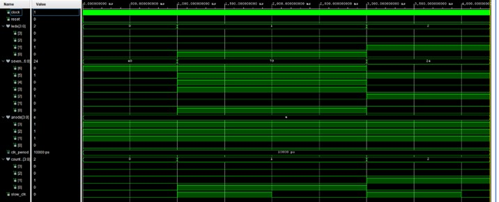
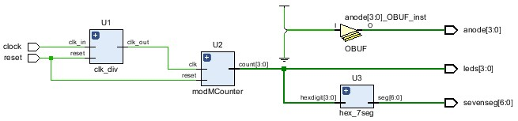
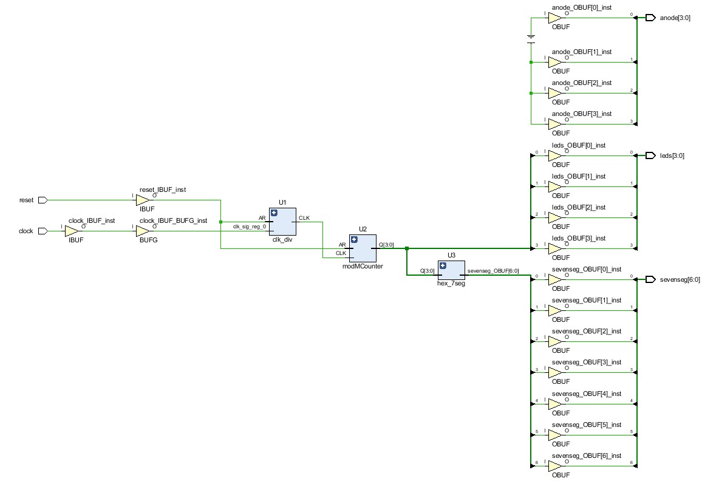
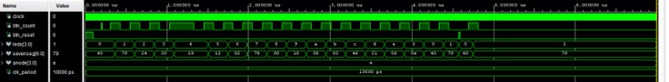
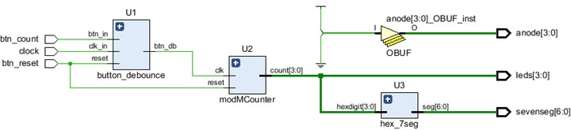
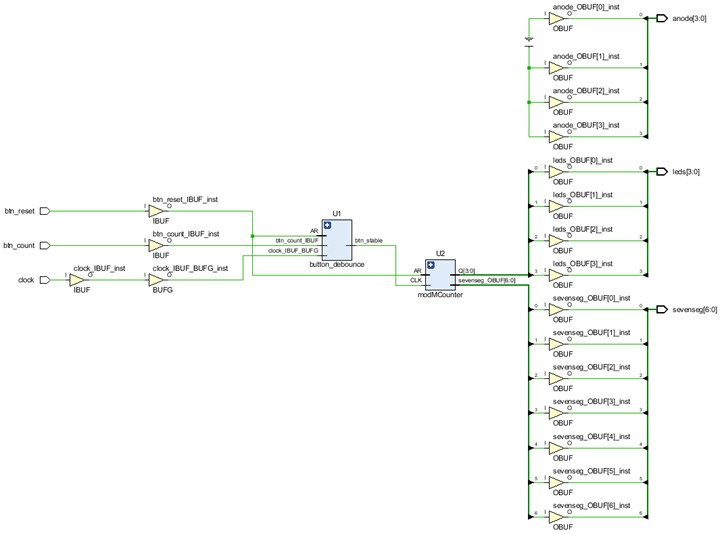

# Project 2: Event Counter

## 1. Introduction

Project 2 implements an **Event Counter** using VHDL on the Basys3 FPGA board. The project was completed in two parts.

### Part 1 – Mod-16 Automatic Counter

Part 1 implements a **4-bit Mod-16 counter** that automatically counts from hexadecimal `0` to `F`. The Basys3 board's 100 MHz clock is divided down to a much slower clock so that the counter output can be observed visually.

The 4-bit counter value is displayed using:

- Four LEDs representing the binary count.
- A seven-segment display representing the same value in hexadecimal.

The main objectives were to:

- Divide the 100 MHz Basys3 system clock to a usable low frequency.
- Create a Mod-16 binary counter.
- Convert the 4-bit count into seven-segment display patterns.
- Integrate the individual modules into a top-level VHDL design.
- Verify the modules through simulation.
- Synthesize and test the complete system on the FPGA.

### Part 2 – Pushbutton Event Counter

Part 2 extends the design into an **event counter**. Instead of automatically incrementing every second, the counter increments when a pushbutton event is detected.

A button-debounce circuit is added so that one physical button press produces one valid count event rather than multiple false counts caused by mechanical switch bouncing.

The completed design demonstrates several important digital-design concepts, including:

- Clock division
- Modular VHDL design
- Binary counting
- Seven-segment decoding
- Pushbutton debouncing
- Hardware integration
- FPGA synthesis and implementation

---

## 2. Design

# Part 1 – Automatic Mod-16 Counter

The Part 1 system contains four major functional blocks:

1. **Clock Divider**
2. **Mod-16 Counter**
3. **Hexadecimal Seven-Segment Decoder**
4. **Top-Level Display Controller**

### System Operation

The Basys3 FPGA provides a 100 MHz clock. This frequency is far too fast to observe directly using LEDs, so the `clk_div` module generates a much slower clock.

The slow clock drives the Mod-16 counter.

The counter produces a 4-bit value:

```text
0000 → 0001 → 0010 → ... → 1110 → 1111 → 0000
```

This corresponds to:

```text
0 → 1 → 2 → ... → E → F → 0
```

The 4-bit count is sent to both the LEDs and the hexadecimal seven-segment decoder.

### Part 1 Block Diagram

```text
                     +----------------+
100 MHz Clock ------>| Clock Divider  |
                     |    clk_div     |
                     +-------+--------+
                             |
                             | slow_clk
                             v
                     +----------------+
                     | Mod-16 Counter |
                     |  modMCounter   |
                     +-------+--------+
                             |
                           count
                         [3 downto 0]
                          /        \
                         /          \
                        v            v
              +--------------+   +----------------+
              | LEDs [3:0]   |   | Hex Decoder    |
              | Binary Count |   |    hex_7seg    |
              +--------------+   +-------+--------+
                                         |
                                         v
                                Seven-Segment Display
```

---

# Part 2 – Pushbutton Event Counter

Part 2 replaces the continuously running count event with a pushbutton-controlled event.

The major blocks are:

1. **Pushbutton Input**
2. **Button Debouncer**
3. **Counter**
4. **Hexadecimal Decoder**
5. **LED / Seven-Segment Outputs**

Mechanical pushbuttons do not generate a perfectly clean transition. A single press can rapidly alternate between logic `0` and logic `1` before becoming stable.

The `button_debounce` module filters these unwanted transitions so that the counter responds to a valid button event.

### Part 2 Block Diagram

```text
                    +-------------------+
Count Button ------>| Button Debouncer  |
                    | button_debounce   |
                    +---------+---------+
                              |
                        Valid Button Event
                              |
                              v
                    +-------------------+
                    |   Mod-16 Counter  |
Reset Button ------>|    / Counter      |
                    +---------+---------+
                              |
                           count[3:0]
                           /        \
                          /          \
                         v            v
                 +------------+   +----------------+
                 | LEDs [3:0] |   | Hex Decoder    |
                 +------------+   |    hex_7seg    |
                                  +--------+-------+
                                           |
                                           v
                                  Seven-Segment Display
```

The final system increments once for each valid button press and can cycle through hexadecimal values from `0` to `F`.

---

## 3. Code

# Part 1 Code

### Design Files

- **Top-level design:** [count_display.vhd](../code/mp2/Part1/count_display.vhd)
- **Clock divider:** [clk_div.vhd](../code/mp2/Part1/clk_div.vhd)
- **Mod-16 counter:** [modMcounter.vhd](../code/mp2/Part1/modMcounter.vhd)
- **Seven-segment decoder:** [hex_7seg.vhd](../code/mp2/Part1/hex_7seg.vhd)
- **Constraints (XDC):** [lab7.xdc](../code/mp2/Part1/lab7.xdc)

> The simulation testbench file is not currently visible in the Part1 GitHub folder and should be uploaded separately if a direct repository link is required.

### Clock Divider

The `clk_div` module reduces the Basys3 100 MHz system clock to a much slower clock that can be observed on the physical FPGA.

Conceptually:

```text
100 MHz system clock
        |
        v
Clock Divider
        |
        v
Slow clock
```

The slow clock is then used to trigger the counter.

---

### Mod-16 Counter

The counter stores a 4-bit value and increments once for each valid clock event.

A 4-bit counter naturally contains 16 possible states:

```text
0000 to 1111
```

or:

```text
0 to F
```

After reaching `1111`, the counter wraps back to `0000`.

---

### Seven-Segment Decoder

The `hex_7seg` module converts the four-bit binary count into the correct seven-segment pattern for hexadecimal values:

```text
0 1 2 3 4 5 6 7 8 9 A B C D E F
```

This allows the same counter value to be viewed in both binary and hexadecimal form.

---

### Top-Level Design

The `count_display` module connects the individual components together.

Its role is to:

- Receive the Basys3 master clock.
- Generate the slow clock.
- Drive the counter.
- Send the count to the LEDs.
- Send the same count to the seven-segment decoder.

---

# Part 2 Code

### Design Files

- **Top-level design:** [count_display.vhd](../code/mp2/Part2/count_display.vhd)
- **Button debounce:** [button_debounce.vhd](../code/mp2/Part2/button_debounce.vhd)
- **Clock divider:** [clk_div.vhd](../code/mp2/Part2/clk_div.vhd)
- **Mod-16 counter:** [modMcounter.vhd](../code/mp2/Part2/modMcounter.vhd)
- **Seven-segment decoder:** [hex_7seg.vhd](../code/mp2/Part2/hex_7seg.vhd)
- **Constraints (XDC):** [lab7.xdc](../code/mp2/Part2/lab7.xdc)

> The Part2 testbench file is not currently visible in the GitHub folder and should be uploaded separately if a direct testbench link is required.

### Button Debounce

The main addition in Part 2 is the `button_debounce` module.

Without debouncing, a single physical button press may be interpreted as several rapid transitions.

Conceptually:

```text
Raw Pushbutton
     |
     |  bouncing signal
     v
+-----------------+
| Button Debounce |
+-----------------+
     |
     | clean event
     v
    Counter
```

The debounced button output provides a stable event that can be used to increment the counter reliably.

---

## 4. Simulation

# Part 1 Simulation

Several simulations were used to verify the Part 1 modules individually before testing the complete system.

### Clock Divider Simulation

The clock-divider simulation verifies that the output clock changes at the required reduced frequency.

 

The high-frequency input clock is divided to generate a slower output clock suitable for driving the counter. The simulated waveform showed the expected clock-divider behaviour. The test confirms that the divider correctly converts the FPGA system clock into the slower timing signal required by the design.

---

### Mod-16 Counter Simulation

The Mod-16 counter was simulated to confirm that the output increments through all sixteen states.

 

The counter should progress from `0000` through `1111` and then return to `0000`. The waveform showed the expected sequential count. The simulation confirmed the correct Mod-16 rollover behaviour.

---

### Slow Clock / Integrated Timing

The slow-clock signal was also observed in simulation to verify that the top-level design receives the correct timing signal.



The counter should respond to the divided clock instead of the original 100 MHz system clock. The slow-clock waveform was generated as expected. These simulations confirmed the correct operation of the Part 1 timing and counting logic before hardware implementation.

---

# Part 2 Simulation

Part 2 focuses on replacing the automatic counting event with a debounced pushbutton event.

The important behaviours verified were:

- Reset initializes the counter.
- One valid pushbutton press increments the counter once.
- Repeated button events continue incrementing the count.
- The count wraps from `F` back to `0`.
- The binary LED output and seven-segment output represent the same counter value.

The use of a debounce module prevents a single physical press from being interpreted as several count events.

---

## 5. Hardware

# Part 1 Hardware

### Elaborated / Top-Level Design

The top-level schematic shows the integration of the clock divider, Mod-16 counter, and seven-segment display logic.

 
 The complete design combines the clock divider, counter, and display modules into one FPGA system. The schematic confirms that the modules are correctly interconnected.

---

### Synthesized Design

After synthesis, Vivado maps the VHDL design into FPGA resources such as LUTs, registers, clock-routing resources, and I/O buffers.

 

---

### Implementation

The completed design was synthesized, implemented, and converted into a bitstream for the Basys3 FPGA.

The physical board was programmed and the counter operation was observed using the LEDs and seven-segment display.

The displayed value progressed through:

```text
0 → 1 → 2 → 3 → ... → E → F → 0
```

---

### Part 1 Hardware Demonstration

The video shows the Part 1 design operating on the Basys3 FPGA.

https://github.com/user-attachments/assets/0163f84f-9705-449b-9edb-67235d826d8e

https://github.com/user-attachments/assets/88e4f7a9-c264-46de-a448-123177c28a3d

The hardware demonstrations confirmed that the counter operated correctly after synthesis, implementation, bitstream generation, and FPGA programming.

---

# Part 2 Hardware

### Top-Level Design

The Part 2 top-level design integrates the pushbutton debounce circuit with the counter and display logic.

 

The top-level design connects the pushbutton input, debounce circuit, counter, reset control, LEDs, and seven-segment output. The system was successfully integrated before synthesis.

---

### Elaborated Design

The elaborated schematic shows the logical relationships between the individual Part 2 modules before FPGA-specific optimization.

| Description | Schematic |
|---|---|
| **Elaborated design** |  |
| The schematic shows how the button-debounce circuit and counting logic interact. | The design structure matched the intended event-counter architecture. |

---

### Synthesized Design

The Part 2 design was synthesized to map the VHDL logic into FPGA hardware resources.



---

### Hardware Testing

The physical FPGA was tested using the pushbuttons and the seven-segment display.

The expected operation was:

```text
Initial state
Count = 0
```

After one valid count-button event:

```text
Count = 1
```

After another valid event:

```text
Count = 2
```

and so on until:

```text
Count = F
```

The following valid event causes rollover:

```text
F → 0
```

The reset input returns the counter to its initial state.

---

### Part 2 Hardware Demonstration

This demonstration shows the pushbutton-controlled event counter operating on the Basys3 FPGA.

https://github.com/user-attachments/assets/8e6a5ba1-f4af-4a58-8608-87029d5ca03a

https://github.com/user-attachments/assets/bfa83c67-8e12-45de-931f-9a07333bc400

The hardware demonstrations showed that valid button events were successfully detected and used to increment the displayed count.

---

## 6. Reflection

Project 2 provided practical experience in designing a larger FPGA system from several reusable VHDL modules.

One of the main challenges in Part 1 was handling the large difference between the **100 MHz Basys3 system clock** and the much slower frequency required for a human-visible counter. A clock-divider module was therefore required to generate a slow timing signal before the counter could be tested on the physical FPGA.

The Mod-16 counter also demonstrated the relationship between binary and hexadecimal values. A four-bit counter provides sixteen possible states, allowing the counter to display values from `0` through `F`.

The seven-segment decoder demonstrated how combinational logic can translate a binary value into the output pattern required by a physical display.

Part 2 introduced another important hardware issue: **mechanical button bounce**. A physical pushbutton does not always transition cleanly from logic `0` to logic `1`. Without debouncing, a single button press could be interpreted as multiple events. Adding the debounce module allowed the FPGA to recognize stable button events and produce predictable counter behaviour.

The project also demonstrated the benefit of modular digital design. Instead of implementing the entire system in one large VHDL architecture, separate components were created for:

- Clock division
- Event counting
- Pushbutton debouncing
- Seven-segment decoding
- Top-level system integration

Each module could be tested independently before being integrated into the complete FPGA design.

Through this project, I gained experience with:

- Clock division
- Clocked VHDL processes
- Modulo counters
- Binary and hexadecimal representation
- Seven-segment displays
- Component instantiation
- Modular VHDL design
- Pushbutton debouncing
- Testbench development
- Simulation waveform analysis
- RTL elaboration
- FPGA synthesis
- Hardware implementation
- Bitstream generation
- Basys3 hardware testing
- Debugging differences between simulation and physical hardware

Overall, Project 2 demonstrated how multiple digital building blocks can be combined into a complete embedded FPGA system. Part 1 established the basic counting and display architecture, while Part 2 extended the system into a practical event counter controlled by real physical inputs.
