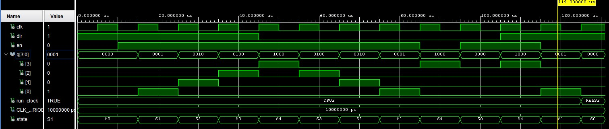
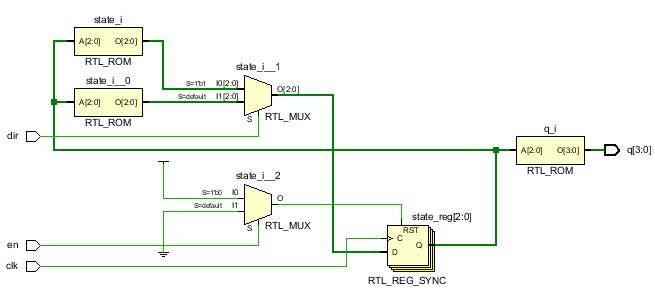

# Project 3: Stepper Motor Control

## 1. Introduction

This project explores the design of a **finite state machine (FSM)** for controlling a four-phase stepper motor using **VHDL and the Basys3 FPGA**. The controller uses **wave-drive mode**, in which only one motor coil is energized at a time. An enable input starts or stops the stepping sequence, while a direction input selects clockwise or counterclockwise rotation.

The objectives are to:

- Design a five-state stepper-motor controller (one idle state and four drive states).
- Verify both directions and the enable function through Vivado behavioral simulation.
- Integrate the FSM with a clock divider that reduces the Basys3's 100 MHz clock to **500 Hz**.
- Map the outputs to the Basys3 PMOD JA connector for use with a **ULN2003 motor driver**.
- Evaluate the synthesized design and test the controller on FPGA hardware.

## 2. Design

The controller contains two main VHDL modules: a clock divider and a stepper-motor FSM. The divider generates a slower clock so the FSM can change motor-coil outputs at the intended stepping rate. The FSM reads `en` and `dir`, then produces a four-bit output `q[3:0]`.

**System block diagram**

```text
             Basys3 FPGA
     +---------------------------------------------+
     |                                             |
     |  100 MHz clk  +-----------+                 |
     | ------------> | clk_div   |                 |
     |               | 500 Hz    | -- slow_clk --+  |
     |               +-----------+               |  |
     |                                           v  |
     |  SW1 (en) ----------------------------> +-------------+
     |  SW0 (dir) ---------------------------> | stepper_    |
     |  Center button (reset) --------------> | motor_FSM   |
     |                 (reset also to divider)|             |
     |                                        +-------------+
     |                                              | q[3:0]
     +----------------------------------------------|------+
                                                    v
                                           PMOD JA1 - JA4
                                                    |
                                                    v
                                             ULN2003 driver
                                                    |
                                                    v
                                              Stepper motor
```

*Figure 1. Controller architecture. The ULN2003 supplies the motor-coil current; the motor has an external supply and a common ground with the FPGA.*

The FSM is a **Moore machine**, so each output pattern depends on the current state.

| State | Output `q[3:0]` | Coil selection |
|---|---|---|
| S0 | `0000` | All coils off |
| S1 | `0001` | `q[0]` |
| S2 | `0010` | `q[1]` |
| S3 | `0100` | `q[2]` |
| S4 | `1000` | `q[3]` |

For `en = 1`, the direction sequences are:

- **Clockwise (`dir = 1`):** S1 → S2 → S3 → S4 → S1
- **Counterclockwise (`dir = 0`):** S4 → S3 → S2 → S1 → S4

When `en = 0`, the original FSM returns to S0 on the next rising clock edge. The FPGA controller design also requires a reset input to return the FSM to S0.

## 3. Code

The FSM is written using an enumerated state type (`S0` to `S4`). A clocked process checks the enable and direction signals and uses `case` statements to choose the next state. A separate output decoder converts the state into a four-bit wave-drive pattern.

```vhdl
type state_type is (S0, S1, S2, S3, S4);
signal state : state_type := S0;

-- Moore output decoder
with state select
    q <= "0000" when S0,
         "0001" when S1,
         "0010" when S2,
         "0100" when S3,
         "1000" when S4;
```

For the FPGA implementation, the top-level controller will instantiate `clk_div` and `stepper_motor_FSM`. The output `slow_clk` from the divider connects to the FSM clock input. The divider is configured for an output frequency of **500 Hz**:

\[
\text{Half-period count}=\frac{100,000,000}{2\times500}=100,000
\]

### Project files

These links use the **actual filenames and folder location** in this repository:

- **FSM design source:** [stepper_motor_FSM.vhd](../code/mp3/part1/stepper_motor_FSM.vhd)
- **FSM testbench:** [stepper_motor_FSM_tb.vhd](../code/mp3/part1/stepper_motor_FSM_tb.vhd)
- **FPGA constraints (XDC):** [stepper_m.xdc](../code/mp3/part1/stepper_m.xdc)

**Part II files to add:** `Stepper_Controller.vhd` and `clk_div.vhd` are required for FPGA implementation but are not shown in the uploaded `code/mp3/part1/` folder. Their links can be added after uploading them. The FSM will also need the reset-enabled version for Part II.

## 4. Simulation

The FSM was tested using **Vivado Behavioral Simulation** with a **10 µs clock period**. The testbench exercises clockwise and counterclockwise rotation, disable, restart, and changes in direction.



*Figure 2. Vivado simulation showing the clock, enable, direction, individual coil outputs, and current FSM state.*

| Test scenario | Expected behavior | Observed result |
|---|---|---|
| Initial condition | S0, output `0000` | Matched |
| Clockwise rotation (`dir = 1`) | `0001 → 0010 → 0100 → 1000` | Matched |
| Counterclockwise rotation (`dir = 0`) | Reverse stepping sequence | Matched |
| Enable LOW (`en = 0`) | Return to S0 on next rising edge | Matched |
| Re-enable in reverse direction | S0 → S4 (`1000`) | Matched |
| Direction changes | Advance according to new direction | Matched |
| Wave-drive operation | At most one coil output HIGH | Matched |

The waveform displays `q[3:0]` as decimal values **0, 1, 2, 4, and 8**, corresponding to the binary values **0000, 0001, 0010, 0100, and 1000**. The individual `q[3]` through `q[0]` signals confirm that only one coil is energized during each drive state.

**Discrepancy and resolution:** One transition in the assignment's reverse-rotation table is inconsistent with the state diagram. The design uses **S1 → S4**, which maintains a continuous four-state counterclockwise sequence rather than returning to the idle state.

## 5. Hardware

### Elaborated design



*Figure 3. Vivado elaborated schematic of the stepper-motor FSM.*

The elaborated design shows the FSM state register, direction-dependent next-state logic, multiplexers, and output decoding. This verifies that the VHDL is structurally interpreted as a state-based digital controller.

**Top-level controller elaboration:** *[Add a screenshot after integrating `clk_div` and `Stepper_Controller`.]*

### Synthesized design

*[Add a synthesized schematic screenshot after running Synthesis. Discuss the flip-flops, clock-divider counter, and combinational state/output logic.]*

### Implementation

The supplied XDC file assigns the FPGA clock, direction switch, enable switch, reset button, and four PMOD JA pins. Timing and implementation results remain to be documented after building the full top-level controller.

*[Add implementation status, timing results, and any warnings here.]*

### Resource utilization

| FPGA resource | Vivado utilization |
|---|---|
| LUTs | *[To be measured]* |
| Flip-flops | *[To be measured]* |
| I/O pins | *[To be measured]* |
| Clock buffers | *[To be measured]* |
| BRAM / DSP | *[To be measured]* |

### Hardware testing

The intended Basys3 controls and motor-driver connections are:

| Signal | FPGA connection | Function |
|---|---|---|
| `clk` | Onboard 100 MHz oscillator | System clock |
| `dir` | SW0 | Rotation direction |
| `en` | SW1 | Enable stepping |
| `reset` | Center button | Return FSM to idle |
| `q[0]` | JA1 → ULN2003 IN1 | Coil D control |
| `q[1]` | JA2 → ULN2003 IN2 | Coil C control |
| `q[2]` | JA3 → ULN2003 IN3 | Coil B control |
| `q[3]` | JA4 → ULN2003 IN4 | Coil A control |

Expected behavior: enabling the controller produces a stepping sequence, changing `dir` reverses it, and disabling the controller de-energizes the coils once the FSM enters S0. The motor must be driven through the ULN2003 rather than directly from FPGA pins.

**Actual FPGA/motor results:** *[Add observations and a photograph after programming and testing the board.]*

## 6. Reflection

This project improved my understanding of **finite state machines, sequential logic, Moore output decoding, and behavioral simulation**. Designing the wave-drive sequence demonstrated how a digital controller can produce an ordered pattern of outputs using a small number of states.

One challenge was interpreting the direction-control transitions correctly. Comparing the provided state table and diagram revealed an inconsistency; correcting the reverse transition allowed the FSM to cycle continuously through all four drive states. The simulation also demonstrated how individual output-bit waveforms can be used to confirm the one-coil-at-a-time requirement.

The next stage extends the FSM into a larger FPGA system by incorporating clock division, reset control, external I/O constraints, and a motor driver. Completing synthesis and physical testing will provide an opportunity to compare verified simulation behavior with operation on real hardware.
