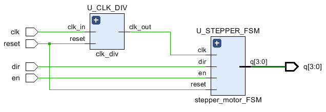
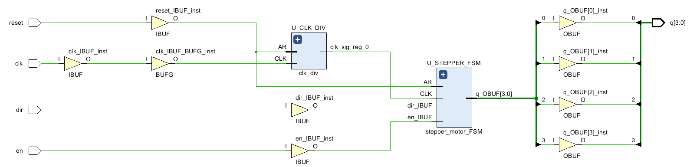

# Project 3: Stepper Motor Control

## 1. Introduction

This project involved designing, simulating, and physically implementing a **stepper motor controller** using **VHDL**, **Xilinx Vivado**, and the **Digilent Basys3 FPGA**. The controller uses a **finite state machine (FSM)** to generate a four-phase wave-drive sequence, allowing the motor to rotate in either direction while providing enable and reset controls.

The project was completed in two parts:

- **Part I — FSM Design and Simulation:** Develop a five-state motor controller and verify its state transitions using a VHDL testbench.
- **Part II — FPGA and Motor Implementation:** Integrate a clock divider, assign FPGA I/O pins, connect the Basys3 to a ULN2003 motor driver, and test the motor physically.

**Project objectives:**

- Design a Moore FSM with one idle state and four coil-activation states.
- Implement clockwise and counterclockwise stepping sequences.
- Verify state transitions, enable control, and direction changes in simulation.
- Convert the Basys3's 100 MHz clock to a 500 Hz stepping clock.
- Implement and test the complete controller on a physical FPGA and stepper motor.

**Final outcome:** The FPGA was programmed successfully, and **all five physical hardware tests passed**, including forward rotation, reverse rotation, enable/disable, and reset.

## 2. Design

### 2.1 System Architecture

The complete controller consists of two principal VHDL modules: `clk_div` and `stepper_motor_FSM`. The top-level `Stepper_Controller` module connects them together.

The clock divider reduces the onboard **100 MHz** clock to **500 Hz**, which is used to advance the FSM. The FSM uses the `dir` and `en` inputs to determine the next active coil, while the reset button returns the controller to its idle state. The four-bit output `q[3:0]` is sent through PMOD JA to the **ULN2003 driver**, which switches the motor coils.

**Figure 1. Block diagram of the complete stepper motor controller.**

```text
    Basys3 100 MHz Clock (W5)
               |
               v
     +--------------------+
     | Clock Divider      |<------ Reset (BTNC)
     | clk_div            |
     | 100 MHz -> 500 Hz  |
     +--------------------+
               |
            slow_clk
               |
               v
     +--------------------+
     | Stepper Motor FSM  |<------ Direction (SW0)
     | S0, S1, S2, S3, S4|<------ Enable (SW1)
     |                    |<------ Reset (BTNC)
     +--------------------+
               |
            q[3:0]
               |
               v
         PMOD JA1-JA4
               |
               v
        ULN2003 Driver
               |
               v
         Stepper Motor
```

### 2.2 FSM Operation

The controller uses **wave drive**: only one motor coil is energized at a time. The FSM has five states, including an idle state.

| State | Output `q[3:0]` | Function |
|:---:|:---:|---|
| S0 | `0000` | Idle — all coils off |
| S1 | `0001` | Energize coil D (`q[0]`) |
| S2 | `0010` | Energize coil C (`q[1]`) |
| S3 | `0100` | Energize coil B (`q[2]`) |
| S4 | `1000` | Energize coil A (`q[3]`) |

The required state sequences are:

- **Direction HIGH (`dir = 1`):** S1 → S2 → S3 → S4 → S1 → ...
- **Direction LOW (`dir = 0`):** S4 → S3 → S2 → S1 → S4 → ...
- **Enable LOW (`en = 0`):** Return to S0 at the next active FSM clock edge.
- **Reset HIGH (`reset = 1`, Part II):** Return immediately to S0, with `q = 0000`.

The output depends only on the current state, so the design is a **Moore finite state machine**.

### 2.3 Clock Divider

The Basys3 has a 100 MHz onboard oscillator. For the hardware implementation, the input is divided to 500 Hz:

\[
T_{step} = \frac{1}{500\ \mathrm{Hz}} = 2\ \mathrm{ms}
\]

Each rising edge of the divided clock advances the FSM by one active state. Four coil patterns therefore form one complete electrical sequence in **8 ms**. The motor's actual mechanical rotation speed also depends on its construction and gear ratio.

## 3. Code

### 3.1 Part I — Stepper Motor FSM

The FSM defines five states (`S0` through `S4`). A clocked process updates the state from `en` and `dir`, while a separate output decoder assigns the corresponding coil pattern.

**Key VHDL code — state transitions:**

```vhdl
if rising_edge(clk) then
    if en = '0' then
        state <= S0;
    elsif dir = '1' then
        case state is
            when S0 => state <= S1;
            when S1 => state <= S2;
            when S2 => state <= S3;
            when S3 => state <= S4;
            when S4 => state <= S1;
        end case;
    else
        case state is
            when S0 => state <= S4;
            when S1 => state <= S4;
            when S2 => state <= S1;
            when S3 => state <= S2;
            when S4 => state <= S3;
        end case;
    end if;
end if;
```

**Key VHDL code — output decoding:**

```vhdl
with state select
    q <= "0000" when S0,
         "0001" when S1,
         "0010" when S2,
         "0100" when S3,
         "1000" when S4;
```

**Part I source files:**

- **Design source:** [stepper_motor_FSM.vhd](../code/mp3/part1/stepper_motor_FSM.vhd)
- **Testbench:** [stepper_motor_FSM_tb.vhd](../code/mp3/part1/stepper_motor_FSM_tb.vhd)
- **Constraints (XDC):** [stepper_m.xdc](../code/mp3/part1/stepper_m.xdc)

### 3.2 Part II — Integrated FPGA Controller

Part II introduces a clock divider and the top-level module `Stepper_Controller`. The divider's `slow_clk` output drives the FSM, and an active-HIGH reset is added to the FSM for hardware control.

**Key VHDL code — module connections:**

```vhdl
U_CLK_DIV : entity work.clk_div
    generic map (
        clk_in_freq  => 100_000_000,
        clk_out_freq => 500
    )
    port map (
        reset   => reset,
        clk_in  => clk,
        clk_out => slow_clk
    );

U_STEPPER_FSM : entity work.stepper_motor_FSM
    port map (
        clk   => slow_clk,
        reset => reset,
        en    => en,
        dir   => dir,
        q     => q
    );
```

**Part II source files:**

- **Top-level design source:** [Stepper_Controller.vhd](../code/mp3/part2/Stepper_Controller.vhd)
- **Clock divider:** [clk_div.vhd](../code/mp3/part2/clk_div.vhd)
- **Clock divider testbench:** [clk_div_tb.vhd](../code/mp3/part2/clk_div_tb.vhd)
- **FSM design (with reset):** [stepper_motor_FSM.vhd](../code/mp3/part2/stepper_motor_FSM.vhd)
- **FSM testbench:** [stepper_motor_FSM_tb.vhd](../code/mp3/part2/stepper_motor_FSM_tb.vhd)
- **Constraints (XDC):** [stepper_m.xdc](../code/mp3/part2/stepper_m.xdc)

## 4. Simulation

### 4.1 Part I — Behavioral Simulation

The FSM was tested using **Vivado Behavioral Simulation** with a **10 µs testbench clock period**. This accelerated clock made the FSM transitions easy to observe in simulation. The physical FPGA implementation instead used the specified **500 Hz** stepping clock.

**Figure 2. FSM simulation showing the clock, enable, direction, state transitions, and four output bits.**


| Test scenario | Expected behavior | Observed result |
|---|---|---|
| Initial idle | S0, `q = 0000` | Passed |
| Clockwise (`dir = 1`) | `0001 → 0010 → 0100 → 1000` | Passed |
| Counterclockwise (`dir = 0`) | `0100 → 0010 → 0001 → 1000` after reversing from S4 | Passed |
| Disable (`en = 0`) | Return to S0 on next clock edge | Passed |
| Restart in reverse | Transition from S0 to S4 | Passed |
| Change direction | Switch to the opposite state progression | Passed |
| One-hot outputs | Only one output HIGH in each active state | Passed |

**Discrepancy and resolution:** The provided counterclockwise state table contained an inconsistent S1 → S0 transition. The final design uses **S1 → S4**, as indicated by the state diagram, to maintain continuous reverse operation. Simulation confirmed the corrected sequence.

### 4.2 Part II — Simulation Scope

The assignment did not require a separate simulation of the integrated top-level controller. The FSM behavior was verified in Part I, and the integrated controller was evaluated through elaboration, synthesis, FPGA programming, and physical motor testing.

## 5. Hardware

### 5.1 Part I — Elaborated Design

**Figure 3. Elaborated schematic of the standalone FSM.**


The schematic shows the FSM control inputs, state register, combinational next-state logic, and four-bit output logic. It confirms the intended structural organization of the VHDL design before synthesis.

### 5.2 Part II — Elaborated Design

**Figure 4. Elaborated schematic of the integrated controller.**



The top-level design contains both the clock divider and the stepper motor FSM. The divider's output is connected to the FSM clock input, while the enable, direction, and reset inputs are routed to the appropriate logic.

### 5.3 Part II — Synthesized Design

**Figure 5. Synthesized schematic of the integrated controller.**



Vivado synthesized the integrated VHDL design into FPGA logic, including the clock-divider counter, FSM state and next-state logic, and I/O connections. The synthesized schematic provides evidence of the mapped design structure; physical behavior was verified separately during hardware testing.

### 5.4 FPGA Pin Assignments and Motor Connections

The Basys3 I/O assignments were specified in `stepper_m.xdc`.

| Signal | Basys3 interface | FPGA package pin | Driver connection |
|---|---|---|---|
| `clk` | 100 MHz onboard clock | W5 | — |
| `reset` | Centre button (BTNC) | U18 | — |
| `dir` | SW0 | V17 | — |
| `en` | SW1 | V16 | — |
| `q[0]` | PMOD JA1 | J1 | ULN2003 IN1 |
| `q[1]` | PMOD JA2 | L2 | ULN2003 IN2 |
| `q[2]` | PMOD JA3 | J2 | ULN2003 IN3 |
| `q[3]` | PMOD JA4 | G2 | ULN2003 IN4 |

The FPGA's PMOD signals control the ULN2003 driver inputs. The motor is powered through its driver using an external supply and a shared ground with the FPGA.

### 5.5 Physical FPGA Testing

After programming the FPGA and connecting the ULN2003 driver, **five functional tests were performed successfully**. The same hardware setup was used to verify the controller's behavior without reprogramming between tests.

| Test | Input conditions | Expected behavior | Actual observation | Result |
|---|---|---|---|---|
| **1. Disabled state** | `SW0=0`, `SW1=0` | Motor stopped; coils off | Motor stopped; all ULN2003 indicator LEDs off | **PASS** |
| **2. Direction HIGH** | `SW0=1`, `SW1=1` | Continuous rotation in one direction | Motor rotated continuously | **PASS** |
| **3. Direction LOW** | `SW0=0`, `SW1=1` | Rotation opposite to Test 2 | Motor rotated continuously in the opposite direction | **PASS** |
| **4. Enable control** | Toggle `SW1: 1 → 0 → 1` | Motor stops and restarts | Motor stopped when disabled and restarted when enabled | **PASS** |
| **5. Reset control** | Hold and release BTNC with `SW1=1` | Motor stops during reset and resumes afterward | Motor stopped while reset was held and restarted when released | **PASS** |

The results matched the expected FSM behavior. In particular, changing SW0 successfully reversed the motor direction, while SW1 and BTNC independently controlled enable and reset. No functional discrepancies were observed in these tests.

### 5.6 Hardware Demonstration Video

**Figure 6. Full hardware demonstration showing all five test scenarios on the Basys3 FPGA.**

<!-- Replace PASTE_YOUR_GITHUB_VIDEO_URL_HERE with the real GitHub video attachment URL. -->
<video src="PASTE_YOUR_GITHUB_VIDEO_URL_HERE" controls width="720">
  Your browser does not support video playback.
</video>

The demonstration video will show:

1. **Disabled state:** SW1 OFF; motor stopped and driver LEDs off.
2. **Direction HIGH:** SW0 ON and SW1 ON; continuous rotation.
3. **Direction LOW:** SW0 OFF and SW1 ON; rotation reverses.
4. **Enable control:** Switching SW1 OFF stops the motor; switching it ON restarts rotation.
5. **Reset:** Holding BTNC stops the motor; releasing it restarts rotation.

https://github.com/user-attachments/assets/9b5e5451-e64c-466f-a88f-e686c69c055c

https://github.com/user-attachments/assets/3e5e3493-adca-401b-b696-90d6d79cae64

https://github.com/user-attachments/assets/a84e825b-1c40-4d13-bde8-90974f9484f2

https://github.com/user-attachments/assets/0788deca-c7ab-421a-9da5-01de0c21bd3f


These tests demonstrate that the physical motor responds correctly to the controller's direction, enable, and reset inputs.

## 6. Reflection

This project provided practical experience designing a **Moore finite state machine**, verifying it in simulation, and deploying it to an FPGA to control an external electromechanical device.

One challenge was interpreting the counterclockwise transitions in the provided state table. Comparing the table with the state diagram and verifying the reverse sequence in simulation helped resolve the inconsistency. Another important challenge was connecting the logical coil-control outputs to the physical hardware through the Basys3 PMOD header and the ULN2003 driver.

Integrating the FSM with a clock divider reinforced the importance of **hierarchical design** and understanding the difference between the high-frequency system clock, the faster testbench simulation clock, and the slower motor-stepping clock. The hardware tests also demonstrated how switches and pushbuttons can control a sequential design without reprogramming the FPGA.

All five hardware tests passed, and the physical results agreed with the intended FSM behavior. This project strengthened my understanding of **state machines, synchronous digital logic, clock division, VHDL testbenches, pin constraints, FPGA synthesis, and hardware interfacing**.
