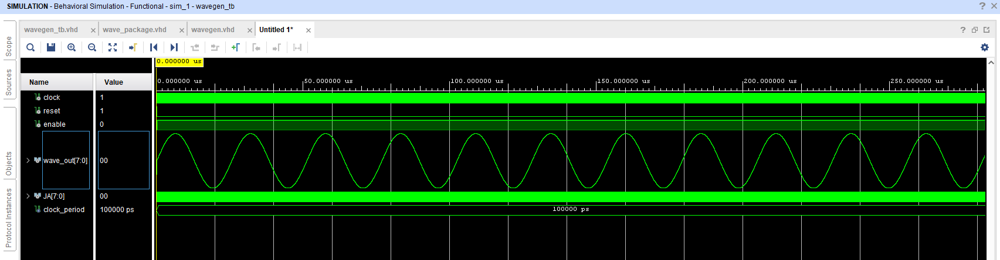
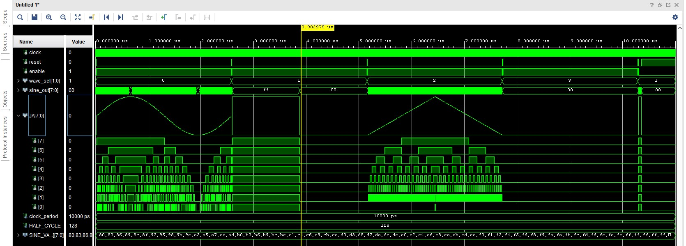
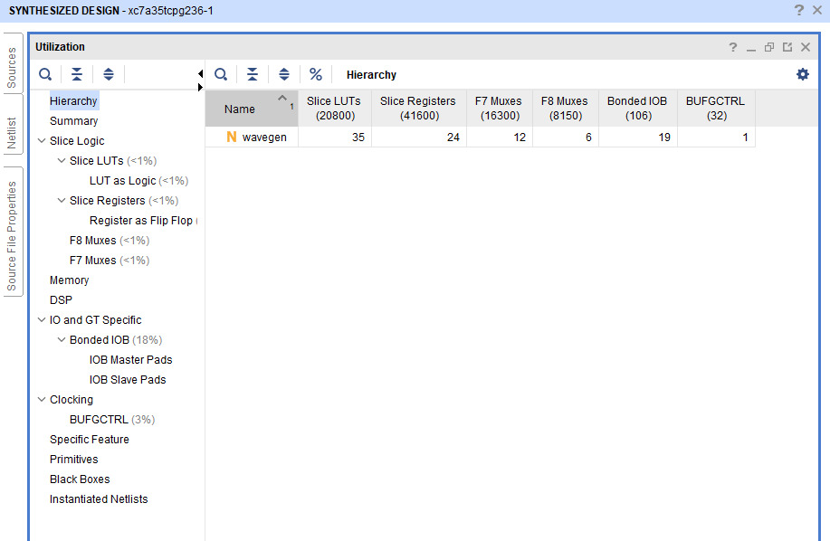
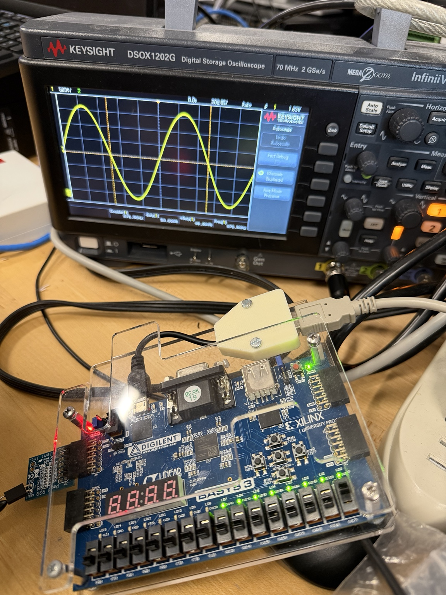
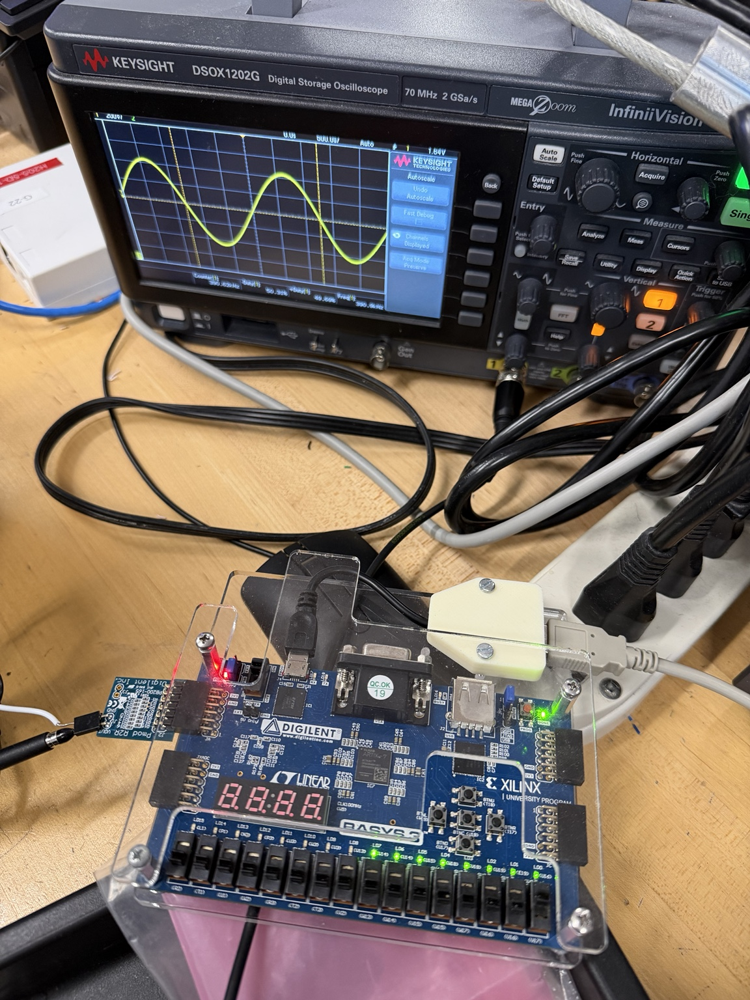
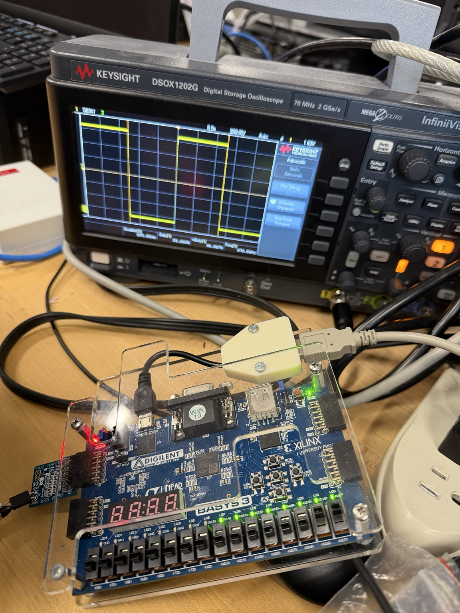
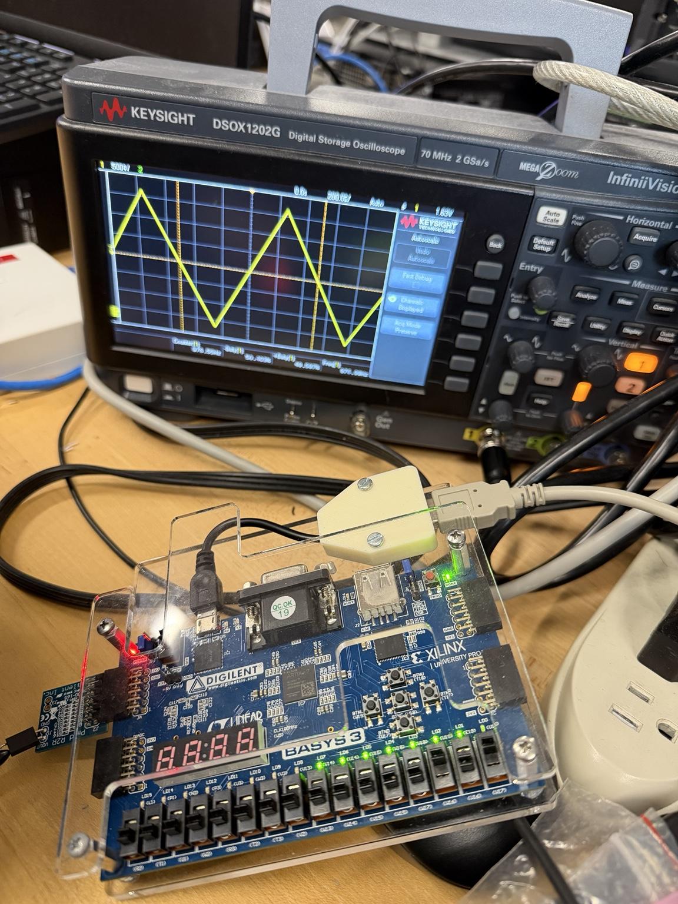
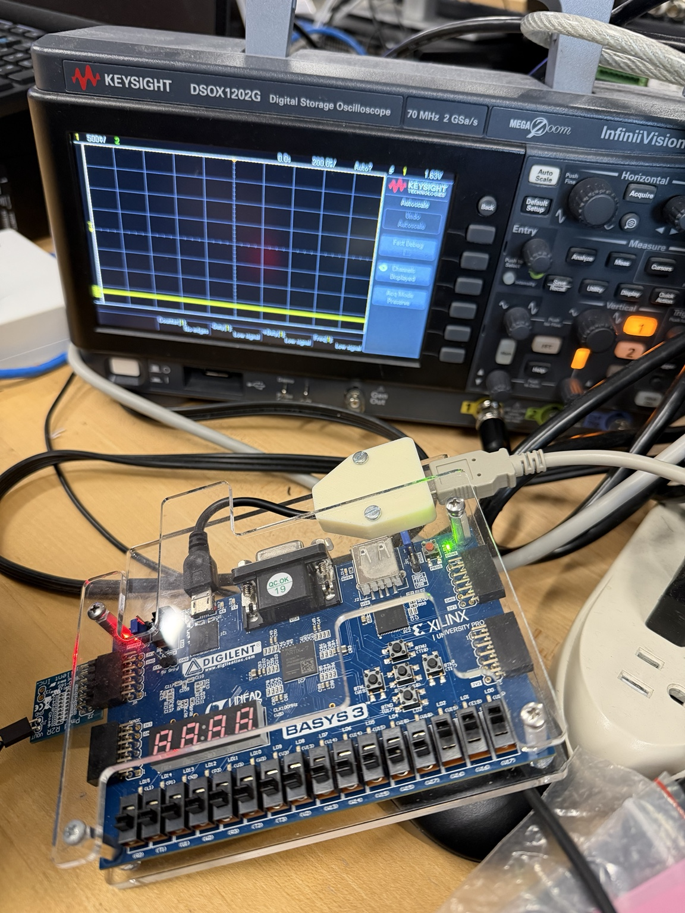

# Project 4: Digital Waveform Synthesizer

## 1. Introduction

This project implements a **digital waveform synthesizer** on the **Digilent Basys3 FPGA (Artix-7 XC7A35T)** using VHDL and AMD/Xilinx Vivado. It demonstrates how sampled digital data and combinational logic can generate periodic signals, which are then converted into analog voltages using a **Pmod R2R digital-to-analog converter (DAC)** and observed on an oscilloscope.

The project was completed in two stages:

- **Part I – Sine-wave generation:** Calculate and store one cycle of an 8-bit sine wave in a 256-entry ROM lookup table, read it sequentially with an address counter, and output the samples through Pmod JA.
- **Part II – Multiple waveforms:** Extend the design to produce **sine, square, and triangle waves**, plus a zero-output mode. SW1 and SW2 select the waveform; all three waveforms use the same address counter and therefore the same period.

**Objectives:** Practice VHDL packages/functions, ROM-based synthesis, counters, digital selection logic, simulation and testbenches, FPGA synthesis/implementation, and external DAC interfacing.

**Hardware and tools:** Basys3 FPGA, Pmod R2R DAC, Keysight DSOX1202G digital storage oscilloscope, and Vivado.

---

## 2. Design

### 2.1 System architecture

```text
                            BASYS3 FPGA (wavegen.vhd)

  W5: 100 MHz CLOCK ------> Sample-update divider ------> 8-bit address counter
                                    ^                          (0 ... 255)
  SW0: ENABLE ----------------------+                               |
  BTNC: RESET ----------------------+                     +---------+---------+
                                                           |         |         |
                                              Sine ROM lookup   Square    Triangle
                                              (wave_package)     logic      logic
                                                           |         |         |
                                                           +----+----+---------+
                                                                |
  SW2/SW1: wave_sel ---------------------------------> 4-way waveform selector
                                                   (sine / square / triangle / 0)
                                                                |
                                                        selected_wave [7:0]
                                                          /             \
                                                   JA [7:0]          sine_out [7:0]
                                                       |                   |
                                                 Pmod R2R DAC          LEDs LD0-LD7
                                                       |
                                                  Analog output
                                                       |
                                                  OSCILLOSCOPE
```

The ROM stores one full sine cycle as **256 addresses × 8 bits per address**. Each update advances the address from `0` to `255` and then wraps back to `0`. In Part II, the **same address** also drives the square- and triangle-wave calculations, ensuring all three have the same number of samples per period.

### 2.2 Inputs, outputs, and selection

| Basys3 control | VHDL signal | Function |
|---|---|---|
| 100 MHz master clock | `clock` | Drives synchronous logic |
| SW0 | `enable` | Allows/pauses sample updates |
| BTNC (center button) | `reset` | Clears address and output |
| SW1 | `wave_sel(0)` | Waveform selection bit 0 |
| SW2 | `wave_sel(1)` | Waveform selection bit 1 |
| Pmod JA (8 data pins) | `JA(7 downto 0)` | Sends 8-bit samples to R2R DAC |
| LEDs LD0–LD7 | `wave_out` (Part I) / `sine_out` (Part II) | Duplicate digital output for visual indication |

| SW2 | SW1 | `wave_sel` | Selected output |
|---|---|---|---|
| 0 | 0 | `"00"` | Sine wave |
| 0 | 1 | `"01"` | Square wave |
| 1 | 0 | `"10"` | Triangle wave |
| 1 | 1 | `"11"` | Zero output |

### 2.3 Waveform resolution and timing

For an 8-bit address counter, each period contains **256 samples**. At a sample rate of `f_sample`, the output frequency is:

```text
f_wave = f_sample / 256
```

- **Part I source:** The address advances every master-clock cycle. With a 100 MHz master clock, the *nominal* waveform frequency from this source is `100 MHz / 256 = 390.625 kHz`.
- **Part II physical design:** A configurable divider, `SAMPLE_DIV = 400`, reduces the sample-update rate to `100 MHz / 400 = 250 ksample/s`, yielding `250,000 / 256 ≈ 976.56 Hz`.
- **Part II simulation:** The testbench overrides `SAMPLE_DIV = 1` for faster simulation; at a 10 ns simulated clock, one complete cycle takes `256 × 10 ns = 2.56 µs`.

The FPGA outputs digital logic levels, **not a continuous analog voltage directly**. The Pmod R2R ladder converts each 8-bit sample to an analog level. The oscilloscope displays the resulting periodic voltage.

---

## 3. Code

### 3.1 Source files

| File | Part I – Sine wave | Part II – Multiple waveforms |
|---|---|---|
| **ROM package** | [wave_package.vhd](../code/mp4/part1/wave_package.vhd) | [wave_package.vhd](../code/mp4/part2/wave_package.vhd) |
| **Design source** | [wavegen.vhd](../code/mp4/part1/wavegen.vhd) | [wavegen.vhd](../code/mp4/part2/wavegen.vhd) |
| **Testbench** | [wavegen_tb.vhd](../code/mp4/part1/wavegen_tb.vhd) | [wavegen_tb.vhd](../code/mp4/part2/wavegen_tb.vhd) |
| **Constraints (XDC)** | [wavegen.xdc](../code/mp4/part1/wavegen.xdc) | [wavegen.xdc](../code/mp4/part2/wavegen.xdc) |

> **Package naming:** The Part I file is named `wave_package.vhd` but declares `sine_package`. The Part II file declares `wave_package`. Each version of `wavegen.vhd` imports the matching package; the two parts should be built with their corresponding files.

### 3.2 Sine-wave sample generation

The VHDL package defines a `rom_type` array and a `sine_rom` function. During synthesis/elaboration, the function fills a table with 256 8-bit samples, scaled to the unsigned range `0` to `255`.

```vhdl
angle := real(i) * (2.0 * MATH_PI / (2.0**addr_bits));
sin_scaled := (1.0 + sin(angle)) * (2.0**data_bits - 1.0) / 2.0;
sine_table(i) := to_unsigned(integer(round(sin_scaled)), data_bits);
```

Examples: address `0` gives approximately `128` (midscale), address `64` gives `255` (peak), address `128` gives `128`, and address `192` gives `0` (trough). The synthesized design implements the constant lookup data as FPGA hardware; the FPGA does not perform real-number `sin()` calculations for each output sample at runtime.

### 3.3 Part I – Reading and outputting sine samples

The initial design uses the address counter to retrieve successive table entries:

```vhdl
sine_table <= sine_rom;
-- Inside the clocked process, when enabled:
sine_vector <= std_logic_vector(sine_table(addr));
-- Output connections:
JA <= sine_vector;
wave_out <= sine_vector;
```

The address counter cycles from 0 to 255 and repeats, producing the periodic sine-data sequence.

### 3.4 Part II – Waveform generation and selection

Part II reuses the sine ROM and adds a `case` statement controlled by the two switch bits:

```vhdl
case wave_sel is
    when "00" =>                  -- Sine: ROM data
        selected_wave <= std_logic_vector(sine_table(addr));

    when "01" =>                  -- Square: 50% duty cycle
        if addr < HALF_CYCLE then
            selected_wave <= (others => '1');
        else
            selected_wave <= (others => '0');
        end if;

    when "10" =>                  -- Triangle: rising/falling ramp
        if addr = HALF_CYCLE - 1 or addr = HALF_CYCLE then
            selected_wave <= (others => '1');
        elsif addr < HALF_CYCLE then
            selected_wave <= std_logic_vector(
                to_unsigned(addr * 2, data_bits));
        else
            selected_wave <= std_logic_vector(
                to_unsigned((max_address - addr) * 2, data_bits));
        end if;

    when others =>                -- "11": zero output
        selected_wave <= (others => '0');
end case;
```

- **Sine:** Uses the 256-entry ROM table.
- **Square:** Outputs hexadecimal `FF` for addresses `0–127` and `00` for addresses `128–255`.
- **Triangle:** Ramps approximately linearly from `0` to `255`, then back to `0` (with the peak held at addresses 127 and 128).
- **Zero:** Outputs `00`.

To keep the physical DAC sample rate manageable, the address and selected output change only when the clock divider reaches its terminal count:

```vhdl
if sample_counter = SAMPLE_DIV - 1 then
    sample_counter <= 0;
    -- Select and register one waveform sample, then advance addr.
else
    sample_counter <= sample_counter + 1;
end if;
```

The output assignments send the same selected 8-bit data to the Pmod interface and LEDs:

```vhdl
JA <= selected_wave;
sine_out <= selected_wave;
```

When `enable = '0'`, the address, divider, and registered output hold their previous states. Asserting `reset` clears the address, divider, and output.

### 3.5 Testbenches and pin mapping

The Part II testbench checks **all 256 addresses in each of four modes**, compares `JA` and `sine_out` with expected values, and includes assertions for disabled-output hold and reset. The testbench uses a 10 ns clock and `SAMPLE_DIV => 1` for efficient simulation.

The XDC files define the 100 MHz clock on pin `W5`, enable on `V17` (SW0), reset on `U18` (BTNC), JA data pins, and LED outputs. Part II additionally maps SW1 (`V16`) and SW2 (`W16`) to `wave_sel`.

---

## 4. Simulation

### 4.1 Part I – Sine-wave ROM simulation

<table>
<tr><th width="44%">Test scenario and results</th><th width="56%">Vivado waveform</th></tr>
<tr>
<td valign="top">
<strong>Scenario 1: Sine-wave generation</strong>
<p><strong>Test:</strong> Enable the ROM reader and cycle through addresses 0–255.</p>
<p><strong>Expected:</strong> The 8-bit output follows one complete sinusoidal sample sequence, then repeats.</p>
<p><strong>Observed:</strong> The simulation shows a repeating sine-wave-shaped output, consistent with sequential ROM lookup. The output bus is a digital sample representation, not a physical analog voltage.</p>
</td>
<td valign="top"><br><em>Figure 1. Part I sine-wave simulation.</em></td>
</tr>
</table>

### 4.2 Part II – All waveform-selection modes

<table>
<tr><th width="44%">Test scenarios and results</th><th width="56%">Vivado waveform</th></tr>
<tr>
<td valign="top">
<p><strong>Scenario 2 – Sine (00):</strong> Expected a continuous ROM-based sine cycle; observed the expected rounded rise and fall.</p>
<p><strong>Scenario 3 – Square (01):</strong> Expected `FF` for one half-cycle and `00` for the next; observed high and low plateaus.</p>
<p><strong>Scenario 4 – Triangle (10):</strong> Expected a linear upward and downward ramp; observed a triangular sample pattern.</p>
<p><strong>Scenario 5 – Zero (11):</strong> Expected constant zero; observed `00`.</p>
<p><strong>Additional checks:</strong> The testbench also includes enable-hold and reset assertions. Each selection uses the same 256-address period.</p>
<p><strong>Display issue:</strong> Analog-view linear interpolation initially introduced misleading diagonal connections between bus values. Switching to Hold interpolation clarified the square and zero-output sections; this was a display setting, not a change to the waveform logic.</p>
</td>
<td valign="top"><br><em>Figure 2. Four waveform modes in the Part II behavioral simulation.</em></td>
</tr>
</table>

**Simulation comparison:** For Part II, the testbench uses a 10 ns clock with `SAMPLE_DIV = 1`, so each complete waveform occupies approximately `2.56 µs`. The physical board uses a slower sample update, but the sample order and waveform shapes remain the same.

---

## 5. Hardware

### 5.1 Elaborated and synthesized designs

**Elaborated design:** The RTL consists of a sine-wave ROM function, sample/address counters, square- and triangle-wave logic, a waveform-selection multiplexer, output registers, and I/O ports. Part II adds the divider and waveform-selection path to the Part I design. These blocks correspond to the architecture diagram in Section 2.

**Synthesized design:** Vivado maps the RTL to LUTs, registers, multiplexer resources, clock buffering, and I/O blocks on the Artix-7 FPGA. The lookup table is implemented as synthesized hardware rather than a runtime software computation. The available screenshots show resource utilization; separate elaborated and synthesized schematic screenshots were not uploaded, so none are represented as actual schematic captures here.

### 5.2 Resource utilization

<table>
<tr><th width="44%">Synthesis resources</th><th width="56%">Part I utilization screenshot</th></tr>
<tr>
<td valign="top">
<p>The Part I design used <strong>35 Slice LUTs</strong>, <strong>24 Slice Registers</strong>, <strong>12 F7 Muxes</strong>, <strong>6 F8 Muxes</strong>, <strong>19 bonded IOBs</strong>, and <strong>1 BUFGCTRL</strong>.</p>
<p>The low logic usage is consistent with a small ROM-based generator. Its 19 IOBs correspond to 3 input pins and 16 output pins.</p>
</td>
<td valign="top"><br><em>Figure 3. Part I utilization report.</em></td>
</tr>
</table>

| FPGA resource | Part I | Part II | Part II available |
|---|---:|---:|---:|
| Slice LUTs | 35 | **55** | 20,800 |
| Slice Registers | 24 | **33** | 41,600 |
| F7 Muxes | 12 | **12** | 16,300 |
| F8 Muxes | 6 | **6** | 8,150 |
| Bonded IOBs | 19 | **21** | 106 |
| BUFGCTRL | 1 | **1** | 32 |

Compared with Part I, Part II uses **20 additional LUTs**, **9 additional registers**, and **2 additional IOBs**. These increases are consistent with the additional waveform logic, sample divider, and SW1/SW2 selection inputs. Overall usage remains small relative to the FPGA's capacity.

### 5.3 Implementation

Both versions were synthesized and implemented for the Basys3 **XC7A35T-1CPG236C** device. In the earlier Part I implementation timing capture, Vivado reported **WNS = +6.044 ns**, **TNS = 0.000 ns**, and **zero failing endpoints**, meaning the analyzed timing constraints were met. A numerical Part II timing report was not among the supplied portfolio images, so no Part II slack value is claimed here.

The programmed Part II FPGA produced the expected selectable analog waveforms through the Pmod R2R DAC, providing additional functional evidence after implementation.

### 5.4 Hardware testing – Part I

<table>
<tr><th width="44%">Scenario and observation</th><th width="56%">Physical measurement</th></tr>
<tr>
<td valign="top"><strong>Scenario 6: Sine-wave output (Part I)</strong><p><strong>Test:</strong> Connect JA to the Pmod R2R and measure the DAC output with the Keysight oscilloscope.</p><p><strong>Expected:</strong> A repeating sinusoidal voltage corresponding to ROM sample values.</p><p><strong>Observed:</strong> A continuous, approximately sinusoidal analog waveform is visible, confirming the digital-to-analog output path. An exact frequency and amplitude measurement is not established from the photograph alone.</p></td>
<td valign="top"><br><em>Figure 4. Part I physical sine-wave verification.</em></td>
</tr>
</table>

### 5.5 Hardware testing – Part II

With **SW0 enabled**, SW2/SW1 were changed between the four modes while monitoring the analog output of the Pmod R2R. Each result is displayed beside its test scenario.

<table>
<tr><th width="44%">Test scenario, expected and observed</th><th width="56%">Basys3 + Pmod R2R + oscilloscope</th></tr>
<tr>
<td valign="top"><strong>Scenario 7: Sine wave — SW2/SW1 = 00</strong><p><strong>Expected:</strong> Repeating sinusoidal waveform from the 256-entry ROM.</p><p><strong>Observed:</strong> Smooth, repeating sine-like analog signal on the oscilloscope. The image supports successful DAC conversion.</p><p><strong>Result:</strong> Matches expected waveform shape.</p></td>
<td valign="top"><br><em>Figure 5. Sine-wave selection.</em></td>
</tr>
<tr>
<td valign="top"><strong>Scenario 8: Square wave — SW2/SW1 = 01</strong><p><strong>Expected:</strong> Output alternates between full-scale high and zero with approximately 50% duty cycle.</p><p><strong>Observed:</strong> Alternating high and low voltage plateaus with sharp transitions.</p><p><strong>Result:</strong> Matches expected waveform shape.</p></td>
<td valign="top"><br><em>Figure 6. Square-wave selection.</em></td>
</tr>
<tr>
<td valign="top"><strong>Scenario 9: Triangle wave — SW2/SW1 = 10</strong><p><strong>Expected:</strong> Approximately linear ramp up to full scale, followed by a linear ramp down.</p><p><strong>Observed:</strong> Repeating rising and falling straight-line segments with distinct peaks and troughs.</p><p><strong>Result:</strong> Matches expected waveform shape.</p></td>
<td valign="top"><br><em>Figure 7. Triangle-wave selection.</em></td>
</tr>
<tr>
<td valign="top"><strong>Scenario 10: Zero output — SW2/SW1 = 11</strong><p><strong>Expected:</strong> A constant zero digital code and a low, flat DAC output.</p><p><strong>Observed:</strong> The oscilloscope trace remains approximately flat near the low level.</p><p><strong>Result:</strong> Matches expected zero mode.</p></td>
<td valign="top"><br><em>Figure 8. Zero-output selection.</em></td>
</tr>
</table>

**Hardware observations:** The three expected waveform *shapes* and the zero mode were reproduced on the physical oscilloscope. With `SAMPLE_DIV = 400`, the design predicts approximately **976.56 Hz** for each nonzero mode; an oscilloscope frequency readout would be required to document the exact measured frequency. The visual tests do not independently establish DAC linearity or total harmonic distortion.

---

## 6. Reflection

This project connected several digital-design concepts: ROM lookup tables, fixed-width numeric conversion, synchronous counters, periodic address wrapping, combinational waveform logic, multiplexers, clock-rate control, simulation, and FPGA I/O constraints. It also demonstrated the difference between **correct digital samples in simulation** and **observed analog voltage on real hardware**.

The most important result was extending a single-purpose sine-wave generator into a reusable, switch-selectable digital synthesizer while retaining the same 256-address timing structure. The FPGA's low resource consumption left substantial capacity for future improvements, such as adjustable output frequency, waveform amplitude control, and additional waveforms.

---

**Project files:** [Part I folder](../code/mp4/part1/) · [Part II folder](../code/mp4/part2/)
